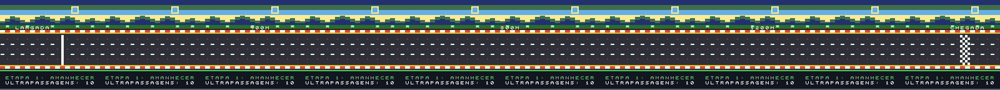
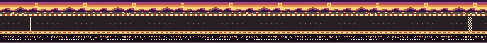
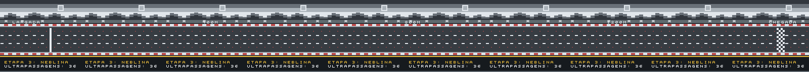
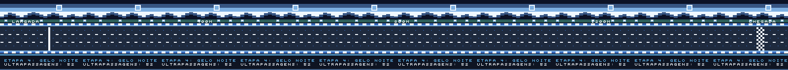

# Cenas do Jogo — Enduro: National Rally

As cenas do jogo representam a progressão contínua da maratona automobilística através de quatro fases climáticas distintas. A cada transição, a iluminação, a paleta de cores e o comportamento da pista sofrem mudanças que afetam diretamente a leitura do traçado e a jogabilidade.

> [!IMPORTANT]
> **Especificação de Resolução:**  
> Todas as cenas foram desenvolvidas no formato widescreen em alta definição com dimensão exata de **1600 × 900 pixels** (proporção 16:9), mantendo estética pixel art nítida e proporções equivalentes para conversão e exibição em motores retrô como o GB Studio.

---

## 1. Etapa 1: Amanhecer Limpo

A largada da prova ocorre sob a luz suave do nascer do sol. A pista corta um amplo vale cercado por montanhas verdejantes, proporcionando máxima visibilidade e condições ideais para acelerar ao limite.

### Características Técnicas e Visuais
* **Dimensões:** 1600 × 900 pixels (padrão HD) | Versão GB Studio: 160 × 144 pixels.
* **Céu e Horizonte:** Gradiente em três faixas (azul profundo, azul claro matinal e dourado no horizonte) com o sol nascendo à direita.
* **Relevo ao Fundo:** Duas camadas de montanhas (uma distante em tons azulados e uma frontal em verde intenso).
* **Estrada:** Asfalto cinza escuro (`#383840`) em perspectiva cônica central (ponto de fuga em X=800, Y=300), com 3 faixas bem demarcadas por faixas tracejadas brancas.
* **Zebras e Acostamento:** Guias com listras alternadas em vermelho vivo (`#C43C22`) e branco (`#F4F4F4`); acostamento em grama viçosa com faixas horizontais de relevo.
* **Elementos em Pista:** Carros rivais em cores vibrantes (amarelo e azul); árvores de folhas verde-escuras e pequenos arbustos nas margens.
* **Objetivo da Etapa:** Ambientação e domínio dos comandos básicos (aceleração, freio e mudança de faixa nas 3 pistas).

---

## 2. Etapa 2: Crepúsculo

O dia se despede e o céu ganha tons dramáticos de fogo e sombras. A transição da luz solar para a penumbra exige que o piloto dobre sua atenção para identificar silhuetas à distância.

### Características Técnicas e Visuais
* **Dimensões:** 1600 × 900 pixels | Versão GB Studio: 160 × 144 pixels.
* **Céu e Horizonte:** Degradê intenso combinando roxo escuro no topo (`#281848`), magenta/violeta no centro (`#8A2460`) e laranja pôr do sol incandescente na linha do horizonte (`#EA682A`).
* **Relevo ao Fundo:** Silhuetas de montanhas escuras em tons de berinjela e grafite contrastando contra o fogo do horizonte.
* **Estrada:** Asfalto em tom mais frio e escurecido (`#26242C`), com zebras alternando laranja crepúsculo (`#E06020`) e cinza claro.
* **Acostamento:** Vegetação escura em tons de verde-musgo sombrio, com árvores em silhueta de folhagem fechada.
* **Elementos em Pista:** Carros rivais verdes e amarelos; a leitura de distância fica mais difícil devido ao contraste reduzido.
* **Desafio da Etapa:** Adaptação à fadiga visual e início do uso de faróis dianteiros e lanternas traseiras.

---

## 3. Etapa 3: Neblina Implacável

Uma espessa e impenetrável camada de névoa envolve a rodovia. O horizonte desaparece e a visibilidade dos carros à frente é drasticamente reduzida, transformando a corrida em um teste puro de reflexos rápidos.

### Características Técnicas e Visuais
* **Dimensões:** 1600 × 900 pixels | Versão GB Studio: 160 × 144 pixels.
* **Céu e Horizonte:** Totalmente encobertos por camadas opacas de cinza névoa (`#828C94`, `#A0A8B0` e `#C0C8D0`). As montanhas tornam-se vultos fantasmagóricos quase imperceptíveis.
* **Estrada:** O asfalto cinza-médio parece sumir a poucos metros do capô do carro do jogador. As zebras ganham tons suaves de vinho desbotado e cinza-claro.
* **Acostamento:** Terreno com baixo contraste em cinza-esverdeado frio.
* **Elementos em Pista:** Carros rivais cinzas camuflados na bruma e silhuetas escuras reveladas apenas pelo brilho rubro das lanternas traseiras (`lanternas.png`).
* **Desafio da Etapa:** Tempo de reação mínimo para desviar de retardatários. O piloto deve guiar-se pelos pontos vermelhos das lanternas.

---

## 4. Etapa 4: Pista de Gelo Noturna

A etapa decisiva da maratona ocorre em plena madrugada, em um trecho de serra congelado. A beleza do céu estrelado contrasta com o perigo mortal da pista escorregadia.

### Características Técnicas e Visuais
* **Dimensões:** 1600 × 900 pixels | Versão GB Studio: 160 × 144 pixels.
* **Céu e Horizonte:** Escuridão profunda de meia-noite (`#0A0E1E` a `#1C2A44`) salpicada de estrelas brancas brilhantes.
* **Relevo ao Fundo:** Cordilheira imponente com picos cobertos de neve pura (`#E4F0FC`).
* **Estrada:** Pista congelada com reflexo azulado (`#2A364C`) e zebras alternadas em azul elétrico (`#2A62F0`) e branco gelo (`#F0F8FF`).
* **Acostamento:** Grandes bancos de neve branca e azulada ladeando as bordas da rodovia; árvores de inverno congeladas.
* **Elementos em Pista:** Carros de gelo em tons de azul-celeste, prata e vermelho escuro.
* **Desafio da Etapa:** **Baixa aderência dos pneus**. O carro continua derrapando lateralmente após os comandos direcionais, exigindo contraesterço suave para não bater nas laterais ou nos rivais.

---

## 5. Resumo Comparativo das Cenas

| Etapa | Iluminação | Paleta Dominante | Efeito Climático / Físico | Dificuldade |
| :--- | :--- | :--- | :--- | :--- |
| **1. Amanhecer** | Luz solar direta | Verde, azul e dourado | Visibilidade total, tração 100% | Normal (Início) |
| **2. Crepúsculo** | Penumbra / Pôr do sol | Roxo, magenta e laranja | Sombras longas, perda de contraste | Moderada |
| **3. Neblina** | Visão difusa | Cinza, grafite e vermelho | Visão cega, aviso por lanternas | Difícil |
| **4. Pista de Gelo** | Noite estrelada | Azul escuro, branco e ciano | Pista escorregadia, derrapagem | Muito Difícil |

---

## 6. Documentos Relacionados

- Narrativa completa: [[História do Jogo]]
- Visão Geral do Game Design: [[GDD - Enduro National Rally]]
- Telas de Início, Vitória e Derrota: [[Telas do Jogo]]
- Física e Direção nas 3 Faixas: [[Mecânicas e Controles]]
- Assets de Arte e Spritesheets: [[Arte e Sprites]]
- Início: [[Inicio]]
