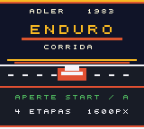
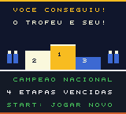
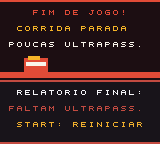
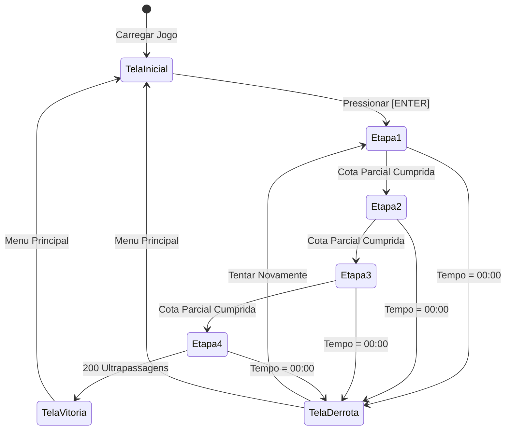

# Telas do Jogo — Enduro: National Rally

Além das cenas dinâmicas de corrida, o jogo possui três telas centrais de navegação e desfecho: **Tela Inicial**, **Tela de Vitória** e **Tela de Derrota**, além da interface de bordo (**HUD**) que acompanha o jogador durante as quatro etapas.

> [!NOTE]
> Todas as telas de interface foram concebidas e renderizadas no formato widescreen com resolução de **1600 × 900 pixels**, unindo a estética clássica dos fliperamas e do Atari 2600 à clareza e fidelidade gráfica para telas modernas.

---

## 1. Tela Inicial (Menu Principal)

A tela de abertura do jogo estabelece a identidade retrô do título, apresentando a máquina da equipe em destaque sobre uma grade de garagem iluminada e o clássico logotipo em relevo cromado e dourado.



### Elementos da Tela
* **Título Principal:** Logotipo **ENDURO** em tipografia arcade robusta, estilizado em amarelo ouro com sombras projetadas em vermelho e contorno de profundidade.
* **Subtítulo:** *"NATIONAL RALLY — 1983 CHALLENGE"*, reforçando a ambientação histórica da competição.
* **Arte Central:** O carro do jogador renderizado em perfil lateral com sua clássica pintura vermelha e faixa aerodinâmica branca, repousando sobre um círculo de holofote no piso quadriculado.
* **Menu de Navegação:**
  - `[ ▶ NOVO RALI ]`: Inicia imediatamente a maratona a partir da Etapa 1 (Amanhecer).
  - `[ GARAGEM ]`: Visualização detalhada das especificações técnicas do veículo.
  - `[ OPÇÕES ]`: Ajustes de volume de áudio (música e efeitos sonoros) e configuração de controles.
  - `[ SAIR ]`: Encerra a sessão do jogo.
* **Instrução de Início:** Mensagem pulsante *"PRESSIONE ENTER PARA INICIAR A CORRIDA"*.

---

## 2. Tela de Vitória (Consagração e Pódio)

Esta tela é exibida quando o piloto cumpre com sucesso o regulamento oficial do National Enduro Challenge, completando todas as quatro etapas e atingindo a marca obrigatória de **200 carros ultrapassados**.



### Elementos da Tela
* **Cabeçalho Triunfal:** Faixa comemorativa dourada com os dizeres:
  * *"VOCÊ CONSEGUIU! O TROFÉU É SEU!"*
  * *"★ CAMPEÃO DO NATIONAL ENDURO CHALLENGE ★"*
* **Cena de Celebração:**
  * Chuva contínua de confetes coloridos (amarelo, verde, vermelho e azul).
  * Torcida vibrando nas arquibancadas com os torcedores oficiais da equipe (`torcedor-azul.png` e `torcedor-vermelho.png`).
  * Pódio olímpico de 3 lugares, com o piloto campeão (`piloto-vitoria.png`) comemorando de braços abertos no degrau central ao lado do cobiçado troféu dourado (`trofeu.png`).
* **Painel de Estatísticas Finais:**
  * **Ultrapassagens Totais:** `200 / 200 (100% da Cota)`
  * **Tempo Final de Prova:** `07:34.82`
  * **Colisões Sofridas:** `0 (Corrida Perfeita — Sem Danos)`
* **Ações Disponíveis:**
  * `[ ENTER ]`: Iniciar uma nova temporada com maior velocidade e tráfego mais denso.
  * `[ ESC ]`: Retornar ao Menu Principal.

---

## 3. Tela de Derrota (Tempo Esgotado)

Aparece quando o cronômetro oficial da federação chega a `00:00` antes de o competidor atingir a cota estipulada de veículos ultrapassados, ou após danos críticos acumulados por batidas sucessivas.



### Elementos da Tela
* **Cabeçalho de Alerta:**
  * *"FIM DE JOGO — O TEMPO ESGOTOU"* em vermelho escarlate vibrante.
  * Subtítulo: *"VOCÊ NÃO ALCANÇOU A COTA DE ULTRAPASSAGENS"*.
* **Composição Visual Dramática:**
  * O carro de corrida estacionado no acostamento escuro com as luzes de emergência (`lanternas.png`) piscando em vermelho.
  * O piloto sentado desolado sobre a guia de asfalto (`piloto-derrota.png`), contemplando a oportunidade perdida.
* **Relatório de Desempenho:**
  * **Ultrapassagens Realizadas:** `182 / 200`
  * **Veículos Faltantes:** `18 carros restantes`
  * **Colisões Registradas:** `5 batidas` (tempo precioso perdido nas retomadas de aceleração).
* **Opções de Ação:**
  * `▶ [ ENTER ] TENTAR NOVAMENTE`: Reinicia a corrida imediatamente para nova tentativa.
  * `  [ ESC ]   RETORNAR AO MENU PRINCIPAL`: Volta para a tela inicial.

---

## 4. HUD (Head-Up Display) Durante a Corrida

Durante toda a pilotagem, a porção inferior da tela exibe um painel de instrumentos embutido de 1600 × 130 pixels que mantém o jogador informado sobre o andamento da prova:

```
┌─────────────────┬──────────────────────┬─────────────────┬────────────────────────┐
│   VELOCIDADE    │     ULTRAPASSAR      │      TEMPO      │      ETAPA ATUAL       │
│    212 KM/H     │      184 / 200       │      02:15      │     1. AMANHECER       │
└─────────────────┴──────────────────────┴─────────────────┴────────────────────────┘
```

1. **Velocímetro Digital:** Informa a velocidade em km/h e a barra de rotação em tempo real. Acelerar até o limite de cruzeiro aproxima os retardatários mais rapidamente.
2. **Contador de Ultrapassagens:** Exibe os carros já passados em relação à cota final (`184 / 200`).
3. **Cronômetro Regressivo:** Contagem regressiva do tempo oficial da etapa atual.
4. **Indicador de Etapa:** Mostra o número e o nome do cenário corrente com a cor temática da fase (verde para Amanhecer, laranja para Crepúsculo, amarelo para Neblina e azul-ciano para Gelo).

---

## 5. Navegação Entre Telas



---

## 6. Documentos Relacionados

- Visão Completa das Pistas: [[Cenas do Jogo]]
- Enredo da Competição: [[História do Jogo]]
- Regras e Física de Pilotagem: [[Mecânicas e Controles]]
- Game Design Document: [[GDD - Enduro National Rally]]
- Sprites e Paletas de Cores: [[Arte e Sprites]]
- Tela Inicial do Cofre: [[Inicio]]
